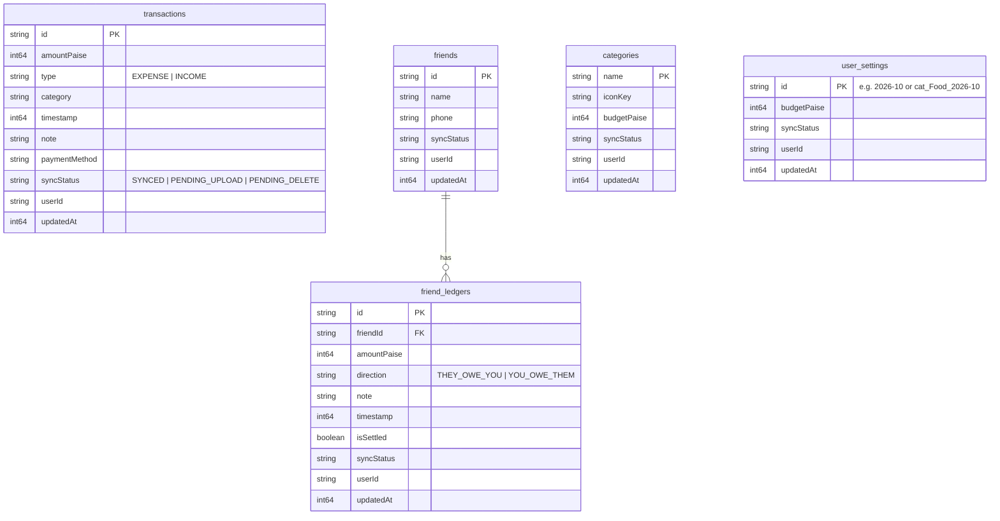
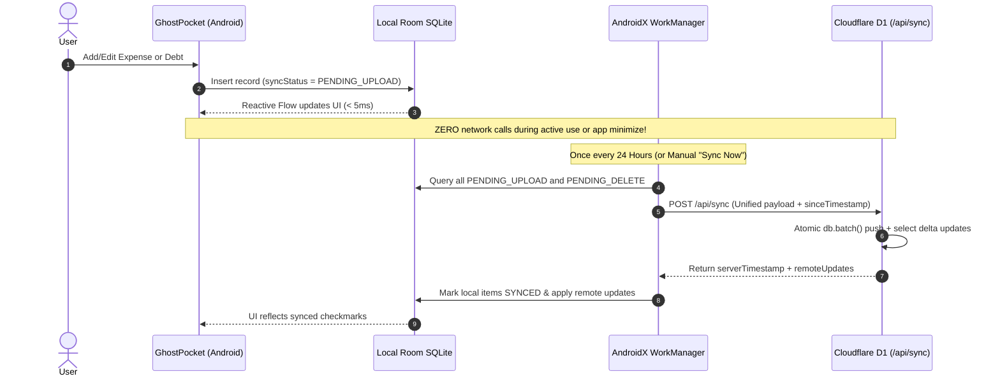

# GhostPocket 👻 — Project Brain & Architectural Evolution

> **Version**: 2.0.0 (versionCode 2)  
> **Platform**: Native Android (Kotlin, Jetpack Compose, Material 3)  
> **Storage & Sync**: Offline-First Room SQLite + Cloudflare D1 Edge SQLite  
> **License**: Open Source  

---

## 🧭 Executive Summary & Core Philosophy

**GhostPocket** is a lightweight, strictly offline-first personal budget, cashflow, and peer debt management Android application. It combines a tactile, monochrome **Claymorphic Bento UI** with mathematically rigorous, ad-free financial tracking.

### Core Architectural Invariants:
1. **Integer Currency Math**: All monetary values are represented strictly in **Paise** (`Long`). Never use floating-point types (`Float` or `Double`) for balance or debt math to avoid roundoff drift.
2. **Pure Cashflow Truth**: Real Net Balance strictly equals $\text{All-Time Income} - \text{All-Time Expenses}$. A budget is a spending limit/target, **never** fake liquid income.
3. **100% Offline-First**: All CRUD operations write immediately to local SQLite via Room in $< 5\text{ms}$. The application functions indefinitely without network access.
4. **WhatsApp-Style Silent Cloud Sync**: Zero background network requests occur while using or exiting the app. Synchronization with the Cloudflare D1 edge database executes **strictly once every 24 hours** in a single atomic batch (or on manual request).
5. **Historical Budget Preservation**: Spending categories and monthly budgets are month-scoped (`cat_<Name>_<YYYY-MM>`). Changing a budget today never alters past month allocations.

---

## 🛠️ Complete Technology Stack

| Layer | Technology | Details |
|---|---|---|
| **Language** | Kotlin 2.0.21 | 100% Native with Kotlin Coroutines & Flows |
| **Compiler & Tools** | JDK 21, KSP 2.0.21-1.0.28 | Android Gradle Plugin 8.7.2 |
| **UI Framework** | Jetpack Compose + Material 3 | Declarative UI, Claymorphism Bento styling |
| **Design System** | Strict Monochrome (Obsidian Dark / Light) | High-contrast bento cards, tactile clay buttons |
| **Architecture** | Unidirectional Data Flow (UDF) + MVVM | StateFlow, SharedFlow, Repository Pattern |
| **Local Database** | Room SQLite 2.6.1 | Type converters, indexed queries, reactive flows |
| **Background Work** | AndroidX WorkManager 2.10.0 | Exponential backoff, battery/network constraints |
| **Edge Backend** | Cloudflare Workers + Hono v4 (TypeScript) | Serverless edge execution, zero cold starts |
| **Edge Database** | Cloudflare D1 (Serverless SQLite) | Global edge database, single atomic batch updates |
| **In-App Updater** | OkHttp 4.12.0 + Android PackageInstaller | GitHub Release polling, SHA-256 verification |

---

## 📜 Chronological Evolution Timeline: What Changed & Why

```
v1.0.0 (Genesis) ──> v1.2.0 (Cashflow Fix) ──> v1.3.0 (Udhaar Ledger) ──> v1.4.0 (In-line Calc)
      │
      └──> v1.5.0 (In-App Updater) ──> v1.6.0 (Cloudflare D1) ──> v1.7.0 (Bugfixes) ──> v2.0.0 (Clean Baseline)
```

### 1. Genesis & UI Conception (v1.0.0 – v1.1.0)
* **What**: Initial prototype built with Jetpack Compose, featuring custom claymorphic components ([`ClayCard`](file:///app/src/main/java/com/ghostpocket/app/ui/components/ClayCard.kt), [`ClayButton`](file:///app/src/main/java/com/ghostpocket/app/ui/components/ClayButton.kt)), and animated ghost mascot moods.
* **Why**: Standard expense tracking apps are bloated, ad-ridden, and visually boring. The goal was a clean, tactile bento-box aesthetic with zero friction.

### 2. The Net Balance Truth Overhaul (v1.2.0)
* **What**: Removed monthly budget addition from liquid balance calculations.
* **Why**: Originally, the app added `initialBudgetPaise` to the dashboard balance, creating "ghost money." If a user had ₹5,000 cash and set a ₹10,000 budget, the app showed ₹15,000. This was corrected so that Net Balance strictly reflects actual cash in hand:
  $$\text{Net Balance} = \sum \text{Income} - \sum \text{Expenses}$$

### 3. Ghost Squad: Bilateral Friend Debt Simplification (v1.3.0 – v1.4.9)
* **What**: Replaced confusing financial terms ("borrowed", "lent", "credit", "debit") with two unambiguous actions:
  - **You Gave 🔴** (`THEY_OWE_YOU`)
  - **You Got 🟢** (`YOU_OWE_THEM`)
* **Why**: College students and roommates were confused by traditional ledger terms. If a friend repays ₹500, tapping "You Got 🟢" immediately balances out the debt. Added equal and custom bill splitting where the payer's share and friend shares reconcile cleanly with overall wallet cashflow.

### 4. Smart In-Line Calculator & Presets (v1.4.7)
* **What**: Integrated math expression evaluation directly into amount fields (`50 + 20 * 2`), complete with tactile operator pills (`+`, `−`, `×`, `÷`, `=`) and quick preset chips (`+₹10`, `+₹20`, `+₹50`, `+₹100`, `+₹500`).
* **Why**: Eliminates switching between a calculator app and GhostPocket when calculating shared auto fares, food bills, or grocery totals.

### 5. In-App Direct Auto-Updater (v1.5.0)
* **What**: Built an internal update engine ([`UpdateManager.kt`](file:///app/src/main/java/com/ghostpocket/app/update/UpdateManager.kt)) that polls GitHub releases, downloads APKs with progress reporting, verifies SHA-256 hashes, and triggers Android's package installer.
* **Why**: For users installing the open-source APK directly from GitHub without the Play Store, this provides seamless 1-tap updates.

### 6. Migration from Firebase to Cloudflare D1 (v1.6.0)
* **What**: Replaced Firebase Auth and Cloud Firestore with Cloudflare Workers + Cloudflare D1 (Serverless SQLite).
* **Why**:
  - Eliminated heavy Google Play Services dependencies and Firebase BOM.
  - Cut network calls in half using a **Single-Roundtrip 2-Way Sync (`POST /api/sync`)** that pushes local dirty records and pulls remote updates in one atomic HTTP transaction.
  - Enabled complete offline operation without requiring Google Play Services on de-Googled devices.

### 7. Historical Navigation & Logical Flaw Fixes (v1.7.0)
* **What**:
  - *Time Drift Fix*: Recording transactions while viewing past/future months anchors timestamps to that selected month (`targetMonth.timeRange().first + 12h`) with a visual badge.
  - *Cloud Sync Lockout Fix*: Account creation month expands dynamically backwards if historical transactions arrive via cloud sync.
  - *Category Rename Budget Migration*: Renaming a category re-keys all historical month-scoped budgets (`cat_<old>_*` ➔ `cat_<new>_*`).
  - *Cascade Friend Deletion*: Deleting a friend cascades to either hard-delete or mark-for-deletion all associated friend ledgers, preventing zombie debts.
  - *Uncategorized Fallback*: Expenses with blank or missing categories automatically group into `"Other"` so category spending totals always equal monthly expense outflow.

### 8. Total Firebase Purge & True WhatsApp-Style Daily Sync (v1.7.1 – v2.0.0)
* **What**:
  - Completely purged all remaining Firebase dependencies, Google Sign-In code, and Google Services plugins, slashing APK size from **23.2 MB down to 18.5 MB**.
  - Removed the aggressive 3-second `ON_STOP` app-exit sync.
  - Transitioned to a **strict once-every-24-hours batch backup** (`scheduleDailyPeriodicSync`) with battery and Wi-Fi checks, matching WhatsApp Google Drive backup behavior.
  - Updated the interactive App Tour ([`AppTourDialog.kt`](file:///app/src/main/java/com/ghostpocket/app/ui/components/AppTourDialog.kt)) to explain the privacy and daily backup model.

---

## 🗄️ Database Schema & Invariants



---

## ⚡ Sync Architecture Details



---

## 📁 Key File Index

- **Application & DI**: [`GhostPocketApp.kt`](file:///app/src/main/java/com/ghostpocket/app/GhostPocketApp.kt)
- **Main Host Activity**: [`MainActivity.kt`](file:///app/src/main/java/com/ghostpocket/app/MainActivity.kt)
- **Primary ViewModel**: [`GhostPocketViewModel.kt`](file:///app/src/main/java/com/ghostpocket/app/viewmodel/GhostPocketViewModel.kt)
- **Financial Calculation Engine**: [`MonthlyFinancialCalculator.kt`](file:///app/src/main/java/com/ghostpocket/app/viewmodel/MonthlyFinancialCalculator.kt)
- **Local Database & DAOs**: [`GhostPocketDatabase.kt`](file:///app/src/main/java/com/ghostpocket/app/data/local/GhostPocketDatabase.kt), [`Daos.kt`](file:///app/src/main/java/com/ghostpocket/app/data/local/Daos.kt)
- **Sync Engine & Worker**: [`SyncWorker.kt`](file:///app/src/main/java/com/ghostpocket/app/sync/SyncWorker.kt), [`CloudSyncEngine.kt`](file:///app/src/main/java/com/ghostpocket/app/data/repository/CloudSyncEngine.kt)
- **Cloudflare D1 Client**: [`D1ApiClient.kt`](file:///app/src/main/java/com/ghostpocket/app/data/remote/D1ApiClient.kt), [`D1Dtos.kt`](file:///app/src/main/java/com/ghostpocket/app/data/remote/D1Dtos.kt)
- **In-App Auto-Updater**: [`UpdateManager.kt`](file:///app/src/main/java/com/ghostpocket/app/update/UpdateManager.kt)
- **Interactive App Tour**: [`AppTourDialog.kt`](file:///app/src/main/java/com/ghostpocket/app/ui/components/AppTourDialog.kt)
- **Cloudflare Worker Backend**: [`backend/src/index.ts`](file:///backend/src/index.ts)
