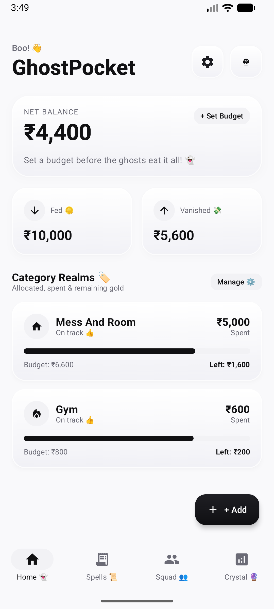
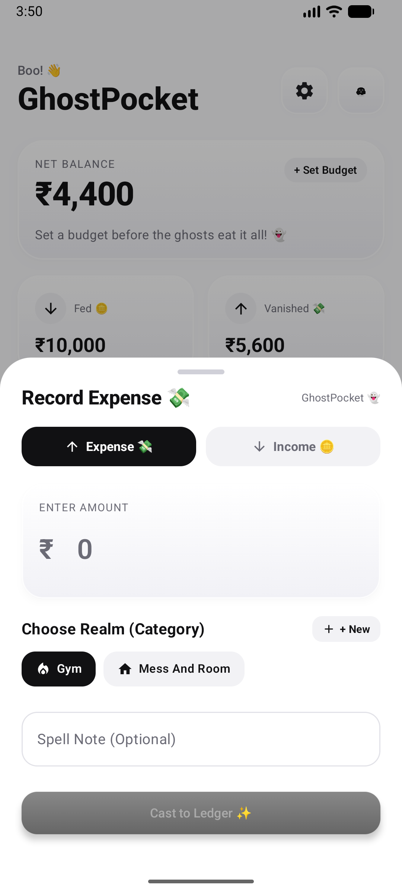
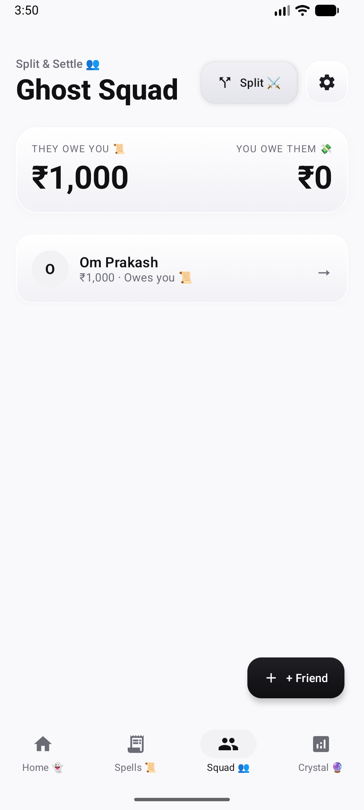
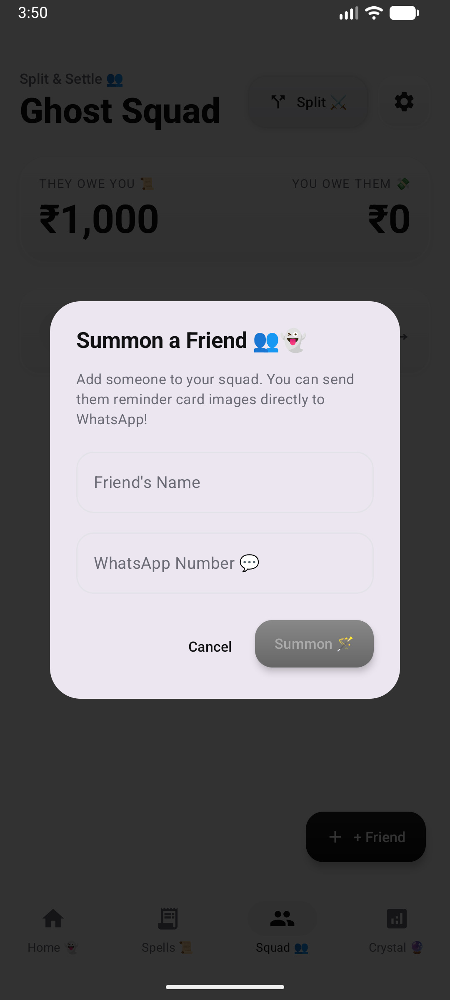
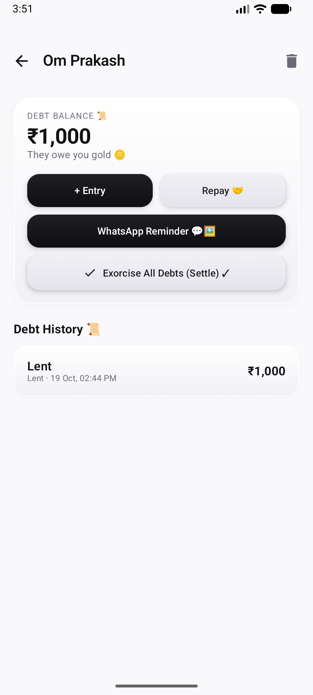
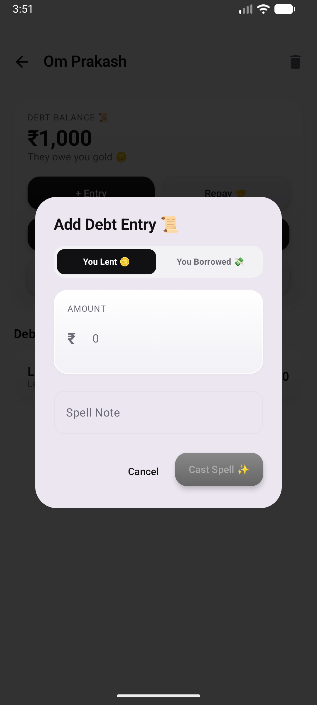
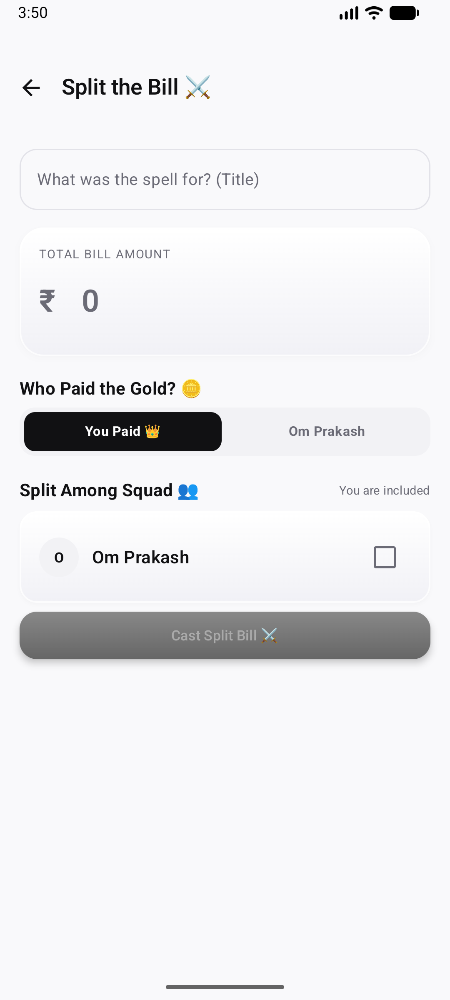
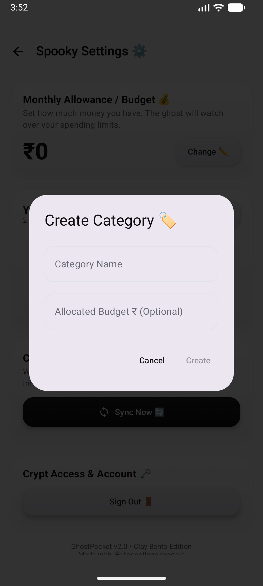
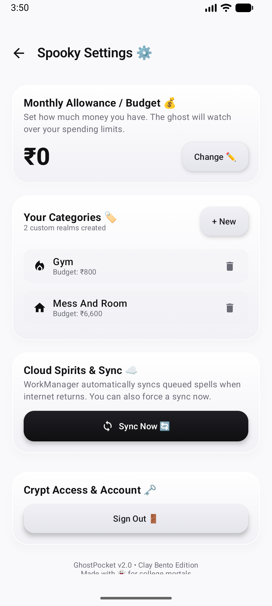

# GhostPocket — Minimal Spooky Student Expense Tracker 👻💰

**GhostPocket** is a native Android expense tracker and shared debt ledger designed specifically for college students. Crafted with a monochrome **Bento Grid + Claymorphism** aesthetic, playful spooky charm, and an offline-first architecture powered by Jetpack Compose, Room, and a cost-optimized **Cloudflare D1 & Workers** backend.

---

## 📸 App Tour & Feature Walkthrough

### 1. Bento Dashboard & Dynamic Ghost Mascot
<div align="center">
  
</div>

- **Unified Tactile Bento Header**: Clean typography (`Boo! 👋 GhostPocket`) flanked by a tactile 3D clay Settings button (`⚙️`) and an animated Mascot avatar card.
- **Dynamic Mascot Moods**: An original micro-mascot blob that reacts to your financial health in real time:
  - 🎩 **Rich Ghost**: When savings are high.
  - 😊 **Happy Ghost**: Balanced spending.
  - 🤔 **Thinking Ghost**: High expense velocity.
  - 😱 **Spooked Ghost**: When you exceed your allowance.
- **Twin Bento Balance Cards**: High-contrast cards for **Fed 🪙** (Income) and **Vanished 💸** (Expenses).
- **Category Realms with Live Gauges**: Real-time progress bars indicating spent vs allocated gold (e.g. *Mess And Room*, *Gym*) with remaining balances.

---

### 2. Fast Transaction Drawer (Cast to Ledger)
<div align="center">
  
</div>

- **Frictionless Logging**: One tap on the tactile floating `+ Add` button summons the curved bottom sheet.
- **Dual Flow**: Instant toggle between **Expense 💸** and **Income 🪙**.
- **Realm Pills**: Quick-tap category selection with a dedicated `+ New` button for creating realms on the fly.
- **Spell Notes**: Add optional context (e.g. *"Evening chai & samosa"*) and hit **Cast to Ledger ✨**.

---

### 3. Ghost Squad (Bilateral Debt Tracking)
<div align="center">
  
</div>

- **College Debt Simplified**: Eliminates awkwardness between friends and roommates by maintaining a transparent ledger.
- **At-a-Glance Totals**: Two dedicated Bento summary blocks:
  - **They Owe You 📜**: Total money lent to friends.
  - **You Owe Them 💸**: Total money you need to pay back.
- **Individual Friend Cards**: Tap any squad member to inspect their complete bilateral ledger.

---

### 4. Summoning Friends with WhatsApp Integration
<div align="center">
  
</div>

- **Seamless Contact Linking**: Enter your friend's name and optional WhatsApp phone number.
- **Zero Third-Party APIs Needed**: The app links natively to the friend's WhatsApp chat without requiring complex external APIs.

---

### 5. Friend Ledgers, Debt History & WhatsApp Reminder Cards
<div align="center">
  
  &nbsp;&nbsp;&nbsp;&nbsp;
  
</div>

- **Bilateral Debt Management**: Add individual lending (`You Lent 🪙`) or borrowing (`You Borrowed 💸`) entries with timestamps and notes.
- **💬 WhatsApp Card Generator**:
  - Automatically draws a custom 1080x1350 reminder card using Android's native Canvas.
  - Features an adorable begging-eyed ghost mascot, speech bubble with the exact amount (₹), and a playful friendship disclaimer.
  - Shares directly to WhatsApp with 0 cloud storage cost!
- **Exorcise All Debts**: Tap to settle all balances with one confirmation.

---

### 6. Fair Bill Splitting Wizard
<div align="center">
  
</div>

- **Split Among Squad ⚔️**: Perfect for shared hostel groceries, cab rides, or group dining.
- **Exact Paise Precision**: Algorithm distributes 1-paisa division remainders fairly so no coins disappear.
- **Payer Selection**: Choose whether you paid or a friend paid, automatically calculating who owes whom.

---

### 7. Custom Category Realms
<div align="center">
  
</div>

- **100% User Defined**: No rigid preset categories. Create custom realms (*Chai*, *Books*, *Hostel Rent*, *Gym*).
- **Allocated Budgets**: Set optional spending limits per category to see live progress bars on the home dashboard.

---

### 8. Spooky Settings & Cloud Spirits Sync
<div align="center">
  
</div>

- **Monthly Allowance**: Configure and update your primary monthly budget.
- **Category Management**: Edit budgets or delete unused realms.
- **Cloud Spirits & Sync ☁️**: 
  - Real-time sync status.
  - "Sync Now 🔄" button triggers an immediate batch push/pull with the Cloudflare D1 backend.
- **Account Control**: One-tap secure Sign Out that safely isolates local Room data.

---

## 🛠️ Technology Stack

| Layer | Technology |
|---|---|
| **Language** | Kotlin 100% Native |
| **UI Framework** | Jetpack Compose + Material 3 |
| **Design System** | Bento Grid + Claymorphism (Strict Monochrome) |
| **Architecture** | Unidirectional Data Flow (UDF) + MVVM |
| **Local Database** | Room Database (SQLite) + Coroutine Flows |
| **Financial Accuracy** | Integer Paise (`Long`) for exact currency math |
| **Backend API** | Cloudflare Workers + Hono v4 (TypeScript) |
| **Edge Database** | Cloudflare D1 (Serverless SQLite) |
| **Live Backend URL** | `https://ghostpocket-backend.omprakashverma-in-fda.workers.dev` |
| **Alternative Backend** | Cloud Firestore + Firebase Auth |
| **Background Sync** | AndroidX WorkManager (Debounced, network-constrained) |
| **Build System** | Gradle Kotlin DSL (`build.gradle.kts`) |
| **Target JDK** | JDK 21 (Temurin / OpenJDK 21) |

---

## ⚡ Cost-Optimized Cloud Sync Architecture

1. **Single-Roundtrip 2-Way Sync (`POST /api/sync`)**:
   - Pushes local dirty records and pulls remote updates in a **single atomic HTTP request**.
   - Cuts Cloudflare Worker invocations in half.
2. **Only-When-Dirty Gating**:
   - Suppresses network calls unless local records have dirty flags (`isDirty == true`) or periodic sync thresholds elapse.
3. **Crypt Data Restoration**:
   - When logging in with an existing account on a new device, a dedicated loading screen with an animated Thinking Ghost and spinner restores your data before rendering the dashboard.

---

## 📦 Building & Sharing the APK

The default APK filename has been configured to build as:
### 🎁 **`GhostPocket-v1.1.0.apk`**

### Build with PowerShell:
```powershell
$env:JAVA_HOME = "C:\path\to\jdk-21"
.\gradlew.bat assembleDebug
```
The output file will be generated at:
`app/build/outputs/apk/debug/GhostPocket-v1.1.0.apk`

### Quick Commands:
- **Locate and open in Windows Explorer**:
  ```powershell
  explorer /select,"app\build\outputs\apk\debug\GhostPocket-v1.1.0.apk"
  ```
- **Install directly to a connected phone**:
  ```powershell
  adb install -r app/build/outputs/apk/debug/GhostPocket-v1.1.0.apk
  ```
- **Publish to GitHub Releases**:
  ```bash
  git push origin main
  gh release create v1.1.0 app/build/outputs/apk/debug/GhostPocket-v1.1.0.apk --title "GhostPocket v1.1.0 👻" --notes "Direct personal email authentication & unified Bento headers"
  ```

---

## 📜 License

Copyright (c) 2026 Om Prakash Verma. All rights reserved.

This software and source code are proprietary and confidential. Unauthorized copying, modification, distribution, sublicensing, or commercial exploitation is strictly prohibited. See [`LICENSE`](file:///d:/Github/Pocket-Budget/LICENSE) for complete terms.
