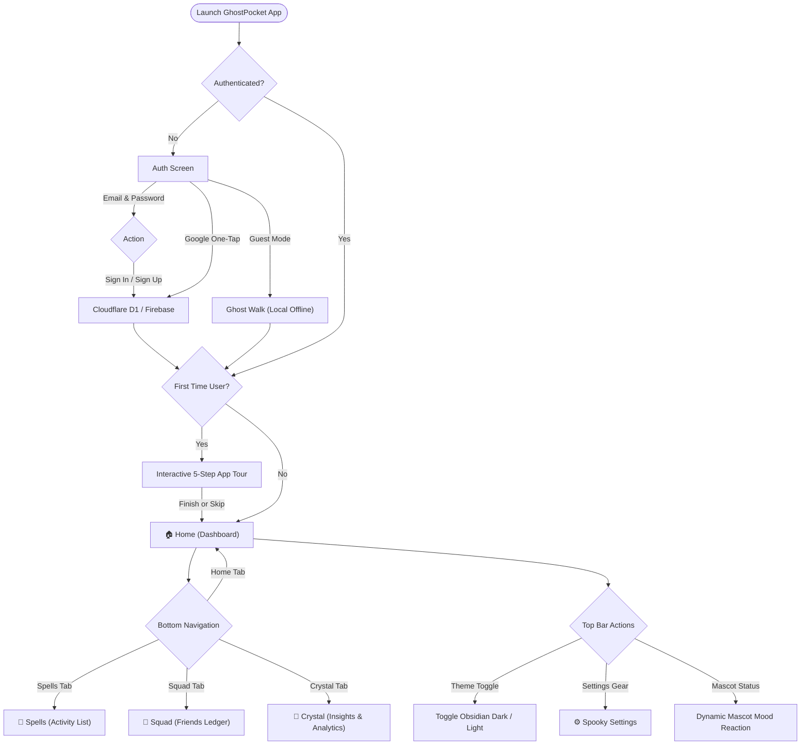
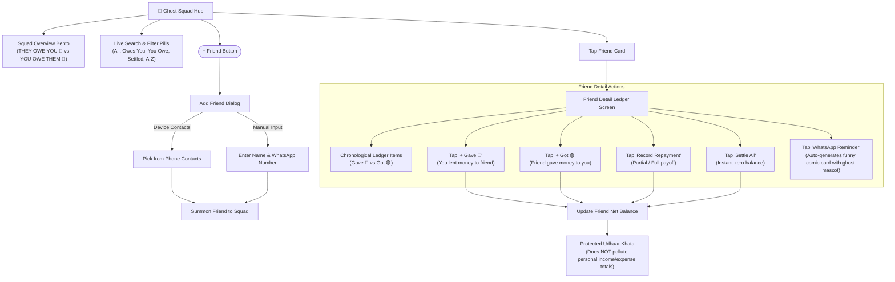
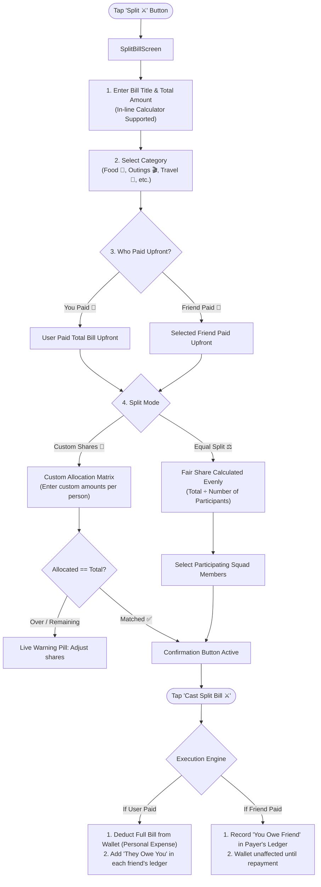
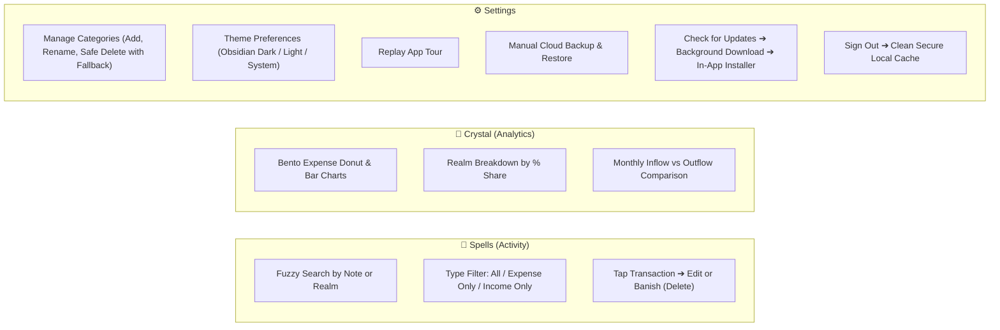

# GhostPocket (Pocket Budget) - Complete User POV Flowcharts

Visual walkthrough of the application architecture, user journeys, decision nodes, and financial data flows from a user's point of view.

---

## 1. Master User Navigation & App Lifecycle

---

## 2. Daily Financial Flow: Income, Expenses & Safe-to-Spend

```mermaid
flowchart TD
    subgraph DashboardView["Dashboard Overview"]
        MonthNav["Month Selector Carousel<br/>(Account Creation Month ➔ Current)"]
        NetCard["Net Balance Bento Card<br/>(All-Time Income − All-Time Expenses)"]
        MonthContext{"Active Month Check"}
        
        MonthNav --> MonthContext
        MonthContext -- Current Month --> SafePill["🎯 Live Safe-to-Spend Pill<br/>(Net Balance ÷ Remaining Days)"]
        MonthContext -- Past Month --> SettledPill["✨ Historical Status Pill<br/>(Net Saved vs Overspent)"]
        MonthContext -- Future Month --> FuturePill["🗓️ Upcoming Month Placeholder"]

        InflowOutflow["Inflow / Outflow Summary<br/>(Total Income vs Total Spent)"]
        CatBudgets["Category Realms<br/>(Spending progress bar & monthly caps)"]
    end

    subgraph AddFlow["Record Transaction (+ FAB)"]
        TapFAB(["Tap + FAB"]) --> OpenSheet["Add Transaction Bottom Sheet"]
        OpenSheet --> TypeToggle{"Choose Type"}
        
        TypeToggle -- Expense 💸 --> EnterExp["Enter Expense Amount"]
        TypeToggle -- Income 🪙 --> EnterInc["Enter Income / Pocket Money"]

        EnterExp --> MathRow["In-Line Arithmetic Calculator<br/>(+, −, ×, ÷, Decimals, BODMAS)"]
        EnterInc --> MathRow
        MathRow --> QuickChips["Quick Amount Chips<br/>(₹50, ₹100, ₹200, ₹500)"]
        
        QuickChips --> PickCategory["Select Realm / Category<br/>(Food, Travel, Outings, or + New)"]
        PickCategory --> EnterNote["Optional Note / Description"]
        EnterNote --> SaveTx(["Save Spell"])
        
        SaveTx --> LiveRecalc["Live Balance & Safe-to-Spend Recalculated"]
        LiveRecalc --> DashboardView
    end
```

---

## 3. Ghost Squad (Friend Debt & Udhaar Khata)

---

## 4. Bill Splitting Flow (Equal & Unequal Shares)

---

## 5. Spells (Activity), Insights (Crystal) & Settings

