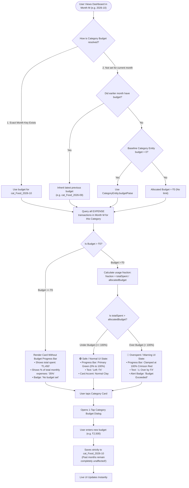
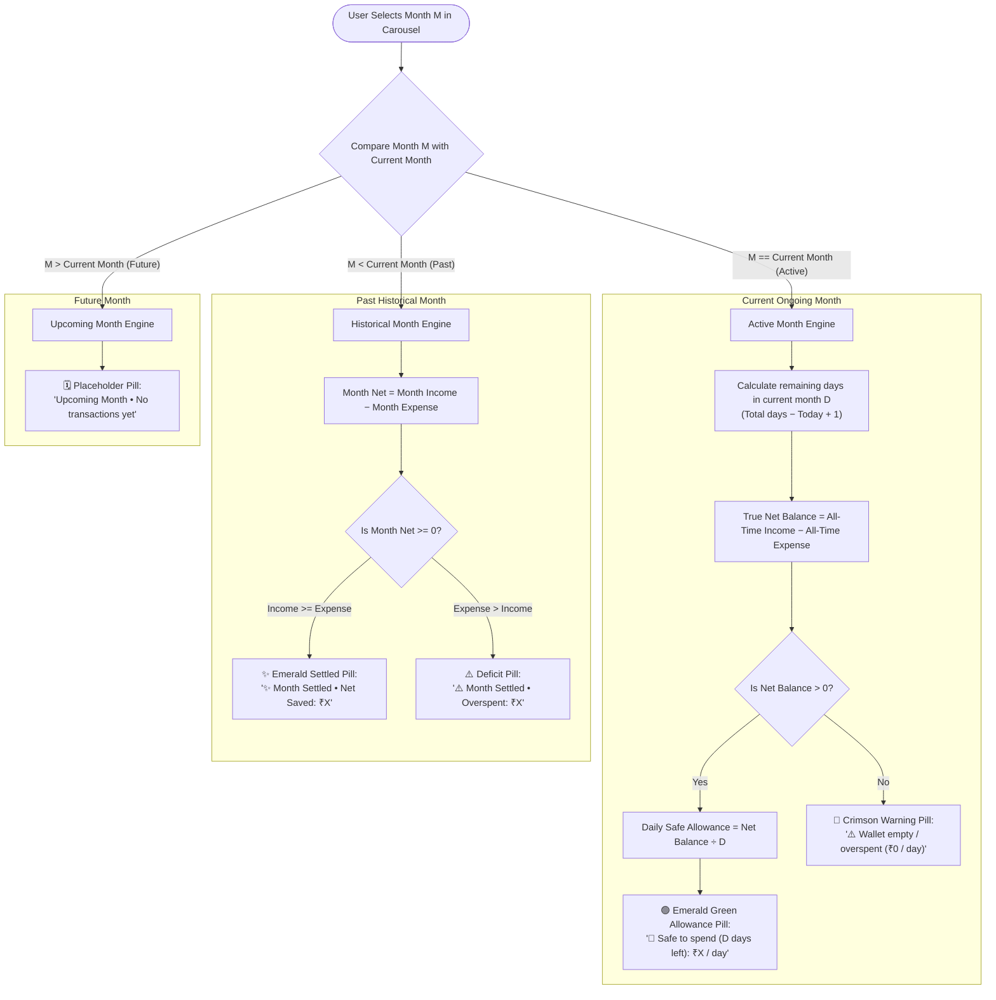
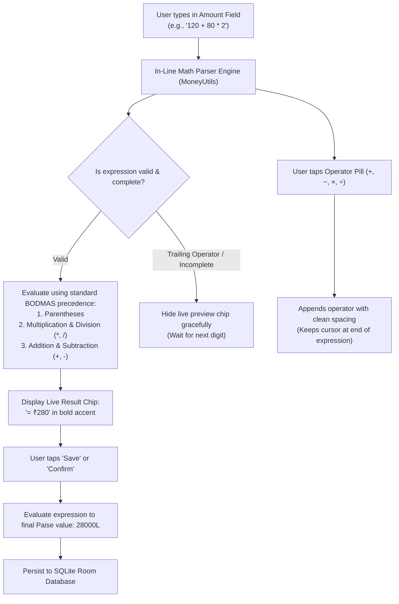
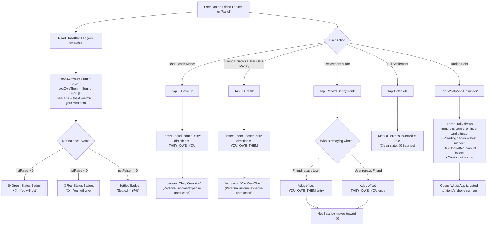
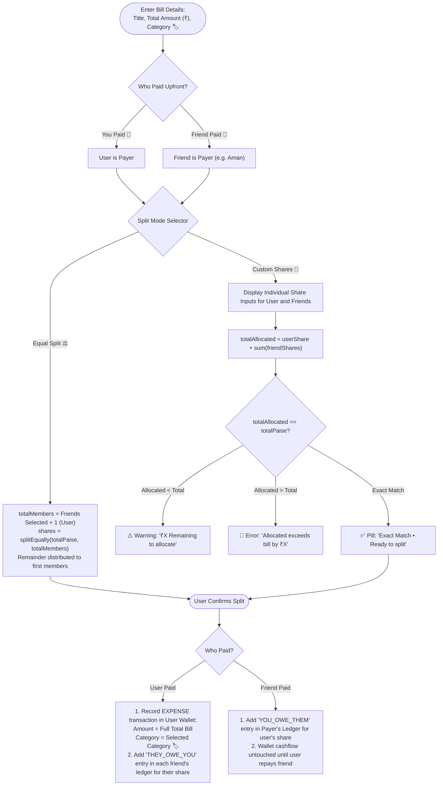
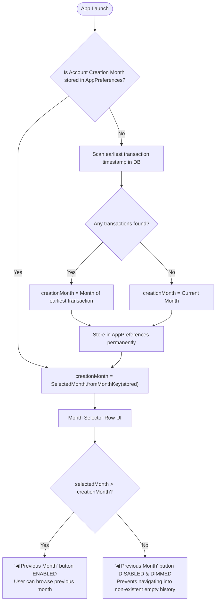

# GhostPocket Logical Decision Flows & State Diagrams

Deep-dive logical flowcharts showing how internal algorithms, budget thresholds, UI indicators, and math engines function under the hood from a user's perspective.

---

## 1. Category Budgeting: Inheritance, Tracking & Visual States

Shows how monthly category budgets inherit values across months, calculate usage, and switch UI visual states (Green vs Red warning).

---

## 2. Dynamic Daily "Safe-to-Spend" & Month Context Logic

Shows how the main Dashboard Balance card switches behavior between Current, Past, and Future months.

---

## 3. In-Line Arithmetic Calculator Flow

Shows how mathematical expressions (`150 + 200 * 2`) are processed live in any amount textfield.

---

## 4. Friend Squad: "Gave" vs "Got" & Udhaar Debt Resolution

Shows how the two-way friend debt ledger works without distorting personal monthly wallet cashflow.

---

## 5. Bill Splitting: Payer & Custom Share Allocation Matrix

Shows how a group bill is divided and logged across both the wallet and squad ledgers.

---

## 6. Month History Boundary & Creation Month Guard

Shows how history navigation is protected against scrolling earlier than account inception.

